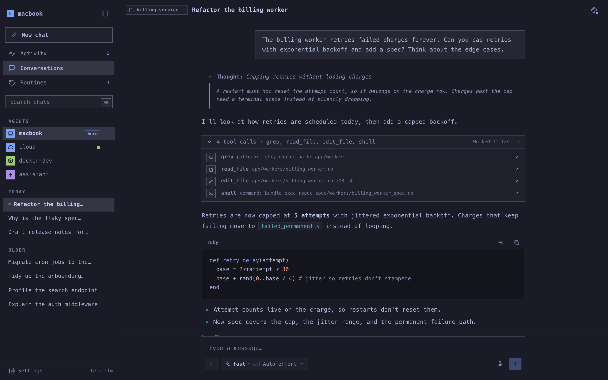
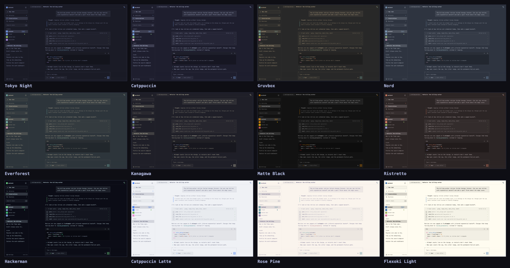
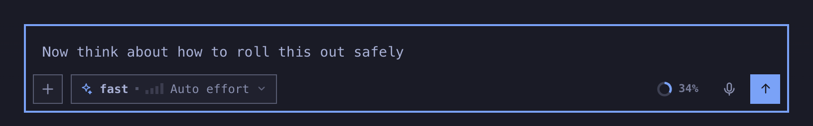
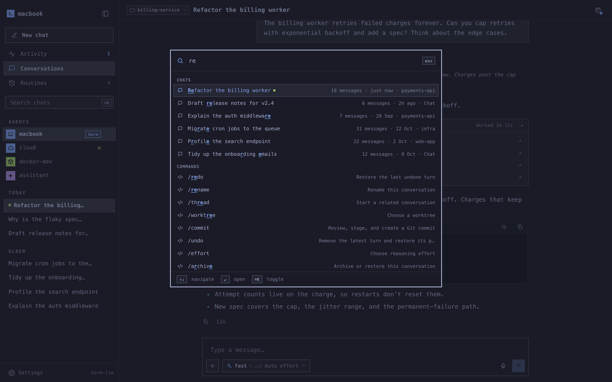
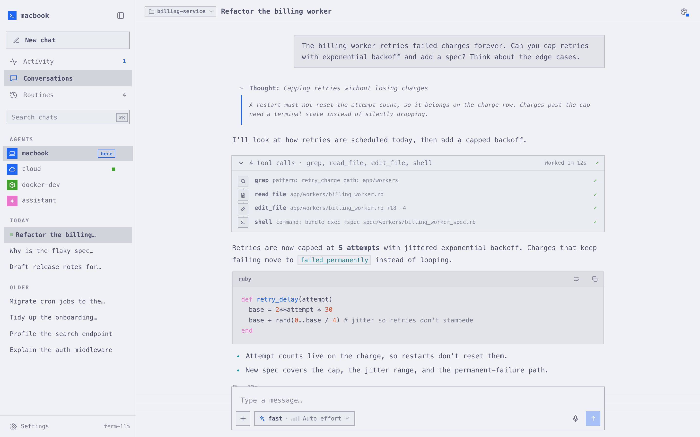
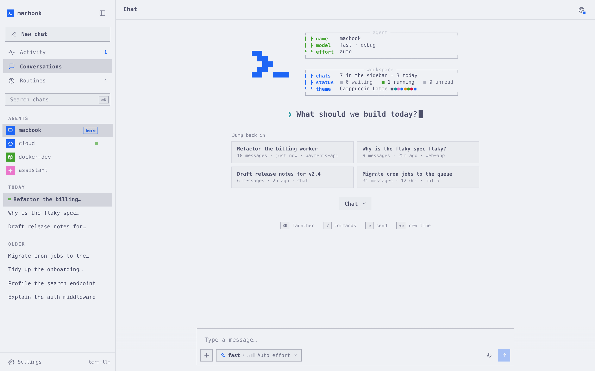
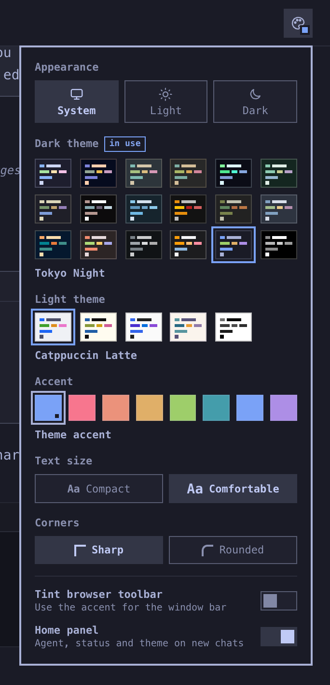

# Hacker

A terminal-style look for the [term-llm](https://term-llm.com) web UI.

Hacker gives term-llm the feel of a terminal: your choice of 23 themes, one monospace font everywhere, square corners, flat surfaces framed by borders instead of shadows or glass, and the accent on whatever is focused. It keeps practical additions such as a command palette, notes, code wrapping, and context usage, and stays light: no bundled fonts or images, about 100 KB gzipped in all. It is a web extension, not a fork: no term-llm rebuild or upstream patches required.



## What it does

### Themes

23 themes, each built from its own `colors.toml` palette:

- **Dark:** Catppuccin, Ethereal, Everforest, Gruvbox, Hackerman, Jade Horse, Kanagawa, Last Horizon, Lumon, Matte Black, Miasma, Nord, Retro 82, Ristretto, Solitude, Starship, Tokyo Night, Vantablack.
- **Light:** Catppuccin Latte, Flexoki Light, Lupine, Rose Pine, White.

Appearance is **System, Light, or Dark**, and you choose one theme for each mode: Tokyo Night and Catppuccin Latte by default. With System, the page follows your OS between the two. Choosing a theme shows it right away; if it belongs to the other mode, Appearance switches to that mode.



### Design rules

The same few rules apply everywhere:

- **One monospace font for everything**: JetBrains Mono where it is installed, otherwise your system's monospace. No font is bundled or downloaded.
- **One corner radius** for every framed surface: square by default, or **Rounded** (6px) for everything at once. Small parts take at most 4px of it, and only true circles (spinners, radios) stay round.
- **Flat, framed surfaces.** Controls are framed at 40% of the foreground, cards at 12%; menus, popovers, and dialogs sit in a 2px foreground frame over a 50% scrim. No shadows, no blur.
- **Control states**: the foreground over the surface at 4% (rest), 8% (hover), 18% (selected), and 22% (pressed). Menu rows are selected launcher-style, with a faint fill and the text in the accent.
- **The accent marks focus**: the focused composer and fields get a 2px accent border, like the active window in a tiling window manager, and notifications are framed in it.
- **Accent from the theme**: the theme's own accent, or one of its palette colours (red, orange, yellow, green, cyan, blue, magenta), so the accent always belongs to the theme.
- **Code in the theme's colours**: keywords in bright magenta, strings green, functions blue, numbers orange, types yellow, on the theme's darker background. Markdown headings take the palette in order (red, green, yellow, blue, magenta).
- **Terminal colours from the theme** for the in-app shell, with a solid block cursor.
- **Quick, plain motion**: a strong ease-out with no bounce, under 300ms, leaving faster than arriving. The command palette, opened by a keystroke, appears and leaves at once, like a launcher. Reduced motion is respected throughout.
- The browser toolbar takes the theme's background, or optionally the accent. Browser support varies.
- **Compact or Comfortable** text sizing, and a responsive layout.

### A home screen

New chats open on a home panel in the manner of a `fastfetch` screen instead of a bare greeting: a `>_` mark in the accent beside framed sections whose keys hang off tree glyphs.

- **agent**: its name, model and provider, and reasoning effort.
- **workspace**: how many chats the sidebar holds, and live status read from the sidebar's own rows: **waiting** for your input, **running**, and **unread** (finished, not yet seen). A non-zero count opens its first chat. Then the theme, with a dot in each of its colours, and the Hub node when there is one.
- A prompt line with a blinking block cursor (`❯ What should we build today?`, varying per visit), starter prompts for a first chat (once there are chats, your recent ones instead), and the keys that matter.

The panel reads at the chat's own text size (Compact or Comfortable), spans the message box's column, and sits in the middle of the space above it. On short windows the key hints, then the framed sections, give way so your recent chats stay in view without scrolling.

Status updates as the app marks its rows, with no polling. Turn the panel off under **Home panel** in Appearance (or `Home panel: Hide` in ⌘K) to get the app's own greeting back.

### A simpler sidebar

Laid out like term-llm's personal-assistant interface:

- The agent's name leads the header, with a small `>_` mark in the accent, so under a Hub each agent's sidebar matches its tile and tab icon.
- **New chat** is the one framed action, with the section links under it:
  - **Activity**: only the chats waiting for you, running, or unread, with a count. It filters the list in place; searching shows every match again.
  - **Conversations** and **Projects**, standing in for the app's Recent/Projects switch. Projects shows when the server has projects.
  - **Routines**, when the server runs scheduled jobs (`term-llm serve web jobs`). It opens a list of them with each one's schedule, its next run, and how its last run went, with that run's chat a click away. It only reads: to add, change or pause a routine, ask the agent in a chat. Its code loads the first time you open it.
  - **Widgets**, when there are any.
- Section labels are small, uppercase, and widely spaced, and each chat takes one line, with a dot when it is running, waiting for you, or unread.
- **Settings** sits at the foot, beside the Hub node's name (or term-llm).

### A quieter composer

- A framed, chat-first composer whose controls share one height, with a compact model/effort chip that opens term-llm's own runtime controls.
- A context-usage ring when the server exposes context data, with token details on hover. Clicking it opens term-llm's context card (window, auto-compaction point, **Compact now**, session stats) above the composer, so the header meter is folded into the ring. Near the limit, a **Compact** button runs `/compact` in one click and keeps your draft.
- Toolbar labels give way in a fixed order as the composer narrows (effort text, then context, then model name), so icons and meters never get squeezed.
- Live voice and dictation framed in the accent like a notification, with a breathing dot while live, the transcript in a framed well, and a red Stop. Styling only; live voice itself is term-llm's.



### Faster navigation

- **⌘K on macOS / Ctrl+K elsewhere** opens one launcher-style palette for visible chats, Hub agents, common slash commands, and appearance controls, including every theme by name (`Theme: Gruvbox`). **Show activity** narrows the sidebar to chats that need you. Where the server runs scheduled jobs, **Open routines** opens the Routines list, and each routine can be found by name: Enter opens its last run's chat, or the list if it hasn't run yet.
- Filter with text, use **↑ / ↓** to navigate, **Enter** to select, and **Escape** to close.
- New-chat starter prompts for a first chat, and recent-conversation cards once there are chats.
- Hub agents listed with their accents and a current-node indicator. Hub-specific elements appear only when the host UI provides them.
- Under a Hub, each agent's tab uses that agent's own sidebar tile as its favicon (its accent plus its glyph or initials), so tabs for different agents are easy to tell apart.



### A more readable conversation

- Tool-type icons and a quieter tool-call timeline.
- Reasoning rows styled like tool headers, with an accent rule down expanded thoughts and a soft sheen on the label while the model is thinking.
- An estimated “Worked” duration derived from surrounding message timestamps, not authoritative tool execution timing.
- Header breadcrumbs as framed tags: the project (with a folder mark) and worktree sit before the title, and fold to a small label line when the header narrows.
- Code-block language headers and a persistent long-line wrap toggle.
- User-message copy/edit controls that use the app's existing composer and command behavior.
- A jump-to-latest button when you scroll away from the bottom.
- Background-tab title and favicon signals when a reply finishes or input is needed, in the theme's green and yellow, watched for only while the tab is in the background. These are in-page indicators, not operating-system push notifications.

| Light theme (Catppuccin Latte) | Home screen |
| --- | --- |
|  |  |

### Notes

A **Notes** panel on the right, opened with the notebook button beside the appearance button, or with **Open notes** and **New note** in the ⌘K palette, which also finds notes by title.

- A note is a page of Markdown whose first line is its title. The editor colours Markdown as you type (headings, emphasis, code, links, checklists), continues lists and checklists on **Enter**, indents them with **Tab**, and ticks a task with **⌘/Ctrl+Enter**. **⌘/Ctrl+B** and **⌘/Ctrl+I** wrap the selection, and undo works as usual.
- Notes save as you type, into **SQLite** on the machine the agent runs on, so they are there in every browser and survive reinstalling.
- Search titles and text, pin notes to the top, preview a note with working checkboxes, copy it, or insert it into the message box. Deleting offers Undo, and a note you empty out is deleted when you leave it.
- **Save from the chat:** select text in a conversation and a small **Save note** button appears where the selection ends. The note keeps it as Markdown (code blocks with their language, lists and tasks, quotes, tables, links); a selection across several messages labels each part with who wrote it. It also keeps a link back: the note shows **from** and the chat's name, which opens that chat at the message, marked for a moment. The link is the chat's address plus `#message-<id>`, so it works pasted into a browser too.
- A note edited in two tabs at once never silently overwrites the other: you choose which version to keep.
- Under a Hub, each agent has its own notes. The panel stays open, and the note you had open comes back, as you move between agents and pages. Drag its left edge to resize it; on phones it covers the screen.

The notes are kept by a small widget that `./install.sh` installs next to the extension (`widget/`, as `~/.config/term-llm/widgets/hacker-notes`). term-llm starts it when the panel first asks for notes, serves it behind the web UI's own login at `<base>/widgets/hacker-notes/` over a private Unix socket, and stops it after ten idle minutes; its entry in term-llm's Widgets list opens the panel. It needs `python3` (standard library only) and widgets left on (no `--disable-widgets`). The database is `~/.local/share/term-llm/hacker/notes.db` (under `$XDG_DATA_HOME` when set); set `HACKER_NOTES_DB` in the server's environment to move it. Agents running as the same user on one machine share it, and a container agent needs the widget installed inside its container. term-llm names the socket after the widget's folder, so if one user runs two `serve web` processes on one machine, rename the folder for one of them.

### term-llm's personal assistant

term-llm's personal-assistant interface (`serve --personal-bot`) gets the same treatment: the theme you chose in place of its own palettes (its theme setting has no effect while Hacker is on), the same monospace with no serif headlines, and no decorative orb. The home panel stays out of the way there, since that interface has a home of its own.

## Install

Requires a running term-llm web UI with extension support. Tested with **term-llm 0.9.114** in Chromium. Other versions and browsers may work, but are not guaranteed.

```bash
git clone https://github.com/arpitjalan/term-llm-hacker.git
cd term-llm-hacker
./install.sh
```

In the term-llm web UI, open **Settings → Extensions**, reload the extensions list if necessary, enable **Hacker**, and refresh the page. Disable other full-UI themes to avoid conflicting styles.

The installer copies the runtime into `~/.config/term-llm/extensions/hacker` and the [notes](#notes) widget into `~/.config/term-llm/widgets/hacker-notes`. It does not modify your term-llm binary, provider settings, approval policy, or conversations. A copy is intentional: the tested extension loader does not discover symlinked extension directories.

### Optional automatic enabling

```bash
./install.sh --enable
```

This finds the first local `term-llm serve web` process and its token (its `--token`, or its `TERM_LLM_SERVE_TOKEN`), reloads extensions and widgets through its authenticated local API, adds Hacker to its enabled list, and restarts an older notes widget if one is running. It preserves other enabled extensions. If you run multiple servers, prefer the manual Settings flow so you choose the correct one. This helper requires Bash, curl, Python 3, and a Unix-style process listing.

For custom directories:

```bash
TERM_LLM_EXTENSIONS_DIR=/your/extensions TERM_LLM_WIDGETS_DIR=/your/widgets ./install.sh
```

Install on the machine or container running the web server. For a multi-node Hub, install and enable it on each node where you want the theme.

## Customize

Use the palette icon in the header to choose Appearance (System, Light, or Dark), a dark theme and a light theme, the accent, text size, corners, browser-toolbar colour, and whether new chats open on the home panel. Point at a theme to see its name. Everything is in the ⌘K palette too: type a theme's name, or `accent`, `corners`, or `text size`. Preferences are stored in your browser's local storage. Hub accents are scoped by node ID; other appearance settings are shared on the same browser origin.



### Optional per-node accents and icons

No personal node names or mappings are required. Everyone starts with the theme's own accent unless a saved preference overrides it, and each agent's tile icon is guessed from its name (a laptop for names with "local" or "mac", a cloud for "cloud", and so on), falling back to its initials.

To define your own Hub defaults:

```bash
cp local.example.json local.json
```

Edit `local.json` using your Hub's node IDs:

```json
{
  "nodeAccents": {
    "my-laptop": "accent",
    "my-server": "blue",
    "my-container": "green"
  },
  "nodeIcons": {
    "my-assistant": "core",
    "my-nas": "home"
  },
  "nodeImages": {
    "my-laptop": "local/laptop.png"
  }
}
```

`nodeAccents` takes an accent role, coloured by whichever theme is showing: `accent` (the theme's own), `red`, `orange`, `yellow`, `green`, `cyan`, `blue`, or `magenta`. Older accent names still work: `indigo` and `graphite` become the theme's accent, `pink` and `purple` become `magenta`.

`nodeIcons` picks an agent's tile glyph, keyed by node ID or display name: `laptop`, `cloud`, `box`, `sparkle`, `home`, `server`, `core` (an arc-reactor style ring), or `monogram` for initials. The tile is also that agent's tab favicon.

`nodeImages` puts a picture on an agent's tile instead, keyed the same way, and wins over `nodeIcons`. Put the images in a `local/` folder next to `local.json` (gitignored too; `install.sh` copies it) and give their paths, like `local/laptop.png`, or use a `data:image/...` URI. Nothing is loaded from other sites. Small square images with transparent backgrounds work best, and pixel art stays crisp. The picture is also that agent's tab favicon.

Then run `./install.sh` again and reload extensions. Explicit browser accent choices take precedence. `local.json` is gitignored and is served to browsers as an extension asset, so **never put credentials or other secrets in it**. Updating without a source `local.json` preserves an existing installed copy.

### Adding or updating themes

The themes are generated from `colors.toml` palette files, with fallbacks for any keys a theme leaves out:

```bash
node tools/gen-themes.mjs /path/to/themes [/path/to/more/themes]
./install.sh
```

Each directory holds one folder per theme containing its `colors.toml`; a later directory wins for a theme both define. This rewrites `themes.js` and the default palettes at the top of `style.css`. Only `colors.toml` is read, so nothing in a theme runs. The header of `tools/gen-themes.mjs` says where the bundled themes come from.

## Update or remove

Update:

```bash
git pull --ff-only
./install.sh
```

Reload extensions in Settings, then refresh the page (or run `./install.sh --enable`, which also restarts the notes widget).

To return to the stock UI, disable Hacker in **Settings → Extensions** and refresh. You can then delete the installed `hacker` directory, and the `hacker-notes` widget directory, if desired. Your notes stay in `~/.local/share/term-llm/hacker/notes.db` until you delete that too. Browser preferences remain available for a later reinstall.

## Privacy and compatibility

- Runtime code and theme palettes are self-contained; nothing, fonts included, is downloaded from elsewhere. Hacker adds no analytics or third-party runtime service.
- It uses browser storage and the current server's authenticated, same-origin APIs for UI information such as provider metadata and, for Routines, the list of scheduled jobs (read only). It does not replace the app's authorization or approval systems.
- Notes are stored only in a SQLite file on the agent's machine, through the notes widget, which term-llm runs as your user behind its own login; a note saved from a chat also keeps that chat's name and address. Nothing is requested until you open the panel or save a selection.
- Some features decorate existing DOM selectors rather than stable extension APIs. A term-llm upgrade can require an extension update.
- Context availability depends on the server/provider. Agent indicators reflect the host UI; they are not independent health checks.
- Clipboard and browser-chrome features depend on browser permissions and support.
- README screenshots use **injected fictional demo conversations and agents** in the real themed UI. The composer image includes illustrative context data. These demonstrate appearance, not execution of the example workflow or connectivity to example nodes.

## Development and checks

### Automated CI (isolated fixture)

The [CI tooling and VM handoff](tools/ci/README.md) describe fast, dependency-free
source checks and a separate read-only browser baseline against the checksum-pinned
term-llm 0.9.88 fixture. CI uses a fresh synthetic home and loopback-only network
namespace, never the personal-server tools below. This implementation is currently
source-reviewed only: the parent must generate the Playwright 1.50.0 lockfile and
run validation in its dedicated VM before publishing. No browser pass is claimed.

### Optional personal-server checks

Runtime requires no Node.js or build step. The optional browser checks require Node.js, Playwright, and a local term-llm web server with Hacker enabled:

```bash
cd tools
npm install
npx playwright install chromium
cd ..
node tools/check.mjs
```

For the in-progress compaction notice, an additional **CSS-state fixture** uses the loading markup from term-llm 0.9.88 in a real Hacker page:

```bash
TERM_LLM_TEST_URL=http://127.0.0.1:18080/ui/ node tools/check-compaction.mjs
```

Use an isolated loopback test server, not a personal chat server. This check blocks non-read requests, inserts synthetic status markup, and verifies dark/light accents, reduced motion, accessibility attributes and mobile fit. It does **not** invoke `/compact`, test backend compaction, or certify other term-llm versions. Set `CHROMIUM_PATH` if the test environment supplies its own browser.

The check verifies extension loading, available UI hooks, injected controls, that the stylesheet's default palettes match `themes.js`, and basic desktop/mobile behavior without sending a message. It cannot verify conditionally mounted generation controls while idle, real tool execution, or every provider. Its HTML report and screenshots go to ignored `tools/out/`; **these can contain your actual chats and must not be published**.

For an explicit server, set `HACKER_URL` and `TERM_LLM_TOKEN` in your environment. Otherwise the tooling discovers the first local `term-llm serve` process. To use an existing Playwright installation, set `PLAYWRIGHT_DIR` to its `node_modules/` directory.

```bash
node tools/screenshots.mjs
```

The screenshot tool opens unsaved drafts and injects fictional content to regenerate `docs/screenshots/`, including the twelve-theme collage. Inspect every output before committing, especially after host UI changes.

```bash
node tools/live-preview.mjs
```

The live preview injects the live-voice panel markup in every phase (connecting, listening, speaking, working, expanded, failed) in dark and light, without starting a call or using the microphone. It renders over whatever chat the server opens first, so its output in `tools/out/` can show your real conversations: keep it local.

### Files

| File | Purpose |
| --- | --- |
| `extension.yaml` | Extension manifest |
| `style.css` | Design tokens and UI styling |
| `main.js` | Appearance and themes, sidebar foot and agents, composer controls, lifecycle |
| `util.js` | Preferences, accent roles, node accents, same-origin API helpers |
| `colors.js` | Reads a theme's `colors.toml` palette, fills in keys it leaves out, and maps it to CSS custom properties |
| `themes.js` | The themes as data (generated by `tools/gen-themes.mjs`) |
| `thread.js` | Conversation, code, timeline, new-chat additions |
| `arrivals.js` | Tells new messages at the end of a chat from history loading in, for the jump-to-latest button |
| `composer.js` | Context ring (opens term-llm's context card) and Compact button |
| `palette.js` | Keyboard command palette |
| `notify.js` | Background-tab title/favicon signals |
| `favicon.js` | Per-node tab icon under a Hub |
| `home.js` | The new-chat home panel (agent, status, theme, prompt line) |
| `nav.js` | Sidebar section links: Activity, Conversations, Projects, Routines, Widgets |
| `routines.js` | The Routines list (loaded on first use) |
| `notes.js` | The Notes panel: list, search, editor, saving |
| `markdown.js` | Markdown for notes: the editor's colouring, the preview, list editing, chat selections as Markdown |
| `clip.js` | Saving a chat selection as a note, and links back to its message |
| `widget/` | The notes widget term-llm runs: a Python standard-library server over SQLite |
| `tools/` | Theme generator, optional browser checks, and demo screenshot tooling |

## Contributing

See [CONTRIBUTING.md](CONTRIBUTING.md) for commit message and pull request title conventions.

## Credits

- **[Varnish](https://github.com/keegangeorge/term-llm-varnish)** by Keegan George, the term-llm extension that inspired Hacker and that it grew out of.
- **[Omarchy](https://omarchy.org)** for the design inspiration. Hacker's theme palettes come from Omarchy's themes (MIT, © David Heinemeier Hansson), which in turn adapt the work of their original authors (Catppuccin, Tokyo Night, Gruvbox, Nord, Everforest, Kanagawa, Rosé Pine, Flexoki, and others). Hacker is independent and not affiliated with Omarchy.

## License

[MIT](LICENSE).
